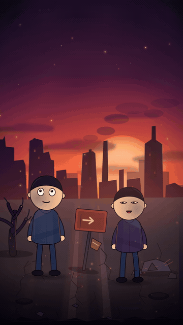

# Popsikos2DAnimations — vertical 2D animation studio



[](https://www.remotion.dev/)

A pure 2D (SVG + React) vertical cartoon built with [Remotion](https://www.remotion.dev/):
**1080×1920, 30 fps**, fully local procedural sound design, multi-voice dialogue with
automatic lip-sync, comic-style Ukrainian typography — plus a **modular location system**
(`src/locations/`), an **Interactive Prop Engine** with nine stateful SVG objects
(`src/props/`), a **Cinematic Shot Engine** with 8 ready-made shot types
(`src/ShotEngine.tsx`) and **advanced character acting** with a modular cast registry
(`src/characters/`), plus a **config-driven Infographic & UI Engine** with seven SVG
components (`src/infographics/`: tactical map, resource markers, counters, schematics,
inventory HUD, warning banner, animated routes) — so you can build new places, new props,
new heroes, new HUD panels and new camera work with an AI agent.

- [English](#english)
- [Українською](#українською)

---

## English

### Quick start

Requirements: Node.js `^20.19.0 || ^22.13.0 || >=24`, Python 3.10+ with `numpy`,
`ffmpeg` + `ffprobe` in `PATH` (only needed for sound and dialogue generation).

```bash
# 1. install dependencies (run inside the repository root)
npm install

# 2. preview in Remotion Studio
npm run dev

# 3. type-check + lint
npm run lint

# 4. regenerate the six base WAVs (numpy + ffmpeg, no network)
python generate_sfx.py

# 5. (optional) automatic voice-over with ElevenLabs (needs .env), also rebuilds the timeline
python generate_voices.py

# 6. (optional) rebuild the dialogue timeline + lip-sync from public/voices/
python build_dialogue.py

# 7. render the film with sound and captions
npx remotion render src/index.ts Popsikos2DAnimations out/episode.mp4 \
  --codec=h264 --crf=18 --image-format=png --pixel-format=yuv420p
```

On Windows PowerShell use `` ` `` instead of `\` for line continuation, or keep the
command on a single line.

### Project in 30 seconds

```
generate_sfx.py        procedural sound synthesis  -> public/sfx/*.wav
generate_voices.py     ElevenLabs TTS (eleven_flash_v2_5) -> public/voices/*.mp3
script_voices.json     voice-over script: file / speaker / text
voices_config.example.json  public Rachel/Adam/Bella/Antoni voice IDs
build_dialogue.py      dialogue timing + lip-sync    -> src/dialogueTimeline.ts
SOUNDS.md              sound catalogue: duration, loudness, mix timeline
AGENTS.md              full agent handbook (environment, rules, checklists)
src/
├─ Root.tsx            composition registration (1080x1920, 30 fps, DURATION)
├─ MainScene.tsx      eight shots, camera, grade, audio mix, text overlays
├─ ShotEngine.tsx      8 cinematic shot types + plates/effects
├─ Character.tsx       SVG actor: eyes, mouths, breathing + 5 arm poses, posture,
│                      gaze targeting, auto-blinks, listening nods, voice amplitude
├─ characters/
│  ├─ types.ts         CharacterPreset / CharacterLook contract
│  ├─ index.ts         registry: CHARACTERS, CharacterId, characterProps()
│  └─ *.ts             survivor_alex, scout_maya, commander_viktor, engineer_noa
├─ props/
│  ├─ types.ts         PropDefinition / PropProps contract, resolvePropFocus()
│  ├─ index.ts         registry: PROPS, PropId, <Prop>, getPropInteractionPoint()
│  ├─ shared.tsx       usePropFrame(), loopPhase(), pulse(), PROP_OUTLINE
│  └─ *.tsx            phone, generator, radio, faucet, pump, tanks, door,
│                      notebook, tools — each with its own states
├─ infographics/
│  ├─ types.ts         InfographicPlacement + 7 config types, InfographicProps union
│  ├─ index.ts         registry: INFOGRAPHICS, typed <Infographic id config/>
│  ├─ shared.tsx       InfoSvg, useInfoClock, springs, palette INFO
│  └─ *.tsx            procedural_map, resource_markers, counters, schematics,
│                      inventory, warning, animated_routes
├─ TextOverlays.tsx    HookTitle + DynamicCaption (spring, comic outline)
├─ Camera.tsx          parallax Layer, camera type, deterministic random
├─ palette.ts          colours + frame constants
├─ dialogueTimeline.ts generated dialogue + speech envelopes + voiceAmplitude()
└─ locations/
   ├─ types.ts         LocationDefinition contract
   ├─ index.ts         registry: LOCATIONS, LocationId, getLocation()
   └─ street/          reference location: Sky, Horizon, Ground, Midground, Embers
```

### Locations are pluggable

A location is just a folder with five SVG layers plus a small manifest:

```ts
// src/locations/index.ts
export const LOCATIONS = {
  street: streetLocation,
  bunker: bunkerLocation, // <- your new location
} as const satisfies Record<string, LocationDefinition>;
```

Pick it by name anywhere in the scene:

```tsx
<MainScene location="bunker" />                 // whole composition
<World camera={camera} location="bunker">…</World> // a single shot
```

The reference implementation lives in `src/locations/street/` and is documented
step by step in [`AGENTS.md`](./AGENTS.md#28-модульна-система-локацій-srclocations-та-створення-нових-локацій).

### Cinematic Shot Engine

`src/ShotEngine.tsx` turns eight named shot types into a camera + effect state. Each
shot is just a `<Sequence>` wrapping `<CinematicShot>`; the render prop gives you the
solved camera, so the location layers stay exactly where they are.

| `type` | Look | Zoom | Default motion / effects |
|---|---|---|---|
| `wide` | full-body characters, lots of sky | 1.02–1.12 | slow push-in, 1.1 px handheld |
| `medium` | two-shot for dialogue | 1.25–1.35 | pan, light DOF |
| `closeup` | face + shoulders, caption-safe headroom | 1.5–1.65 | push-in, auto `panY` lift, DOF 2.5 px |
| `extreme-closeup` | eyes fill the frame | 2.1–2.4 | entry impulse, vibration, grain, flash |
| `top-down` | top projection: head-tops and surface props | 1.14–1.26 | orbital pan, roll ±1.8° |
| `pov` | first-person street view with shoulders | 1.16–1.26 | 7 px handheld, 1.85 Hz walk cycle, vignette |
| `object-focus` | object dead centre with a reticle | 1.7–1.95 | push-in, back layers blurred |
| `map` | 2D tactical map: routes, markers, HUD | 1.0–1.05 | static, scanline |

```tsx
import { CinematicShot } from "./ShotEngine";

<Sequence from={450} durationInFrames={225} name="03 Close-up">
  <CinematicShot
    type="closeup"
    durationInFrames={225}
    target={{ x: 540, y: 986 }}   // actor-plane coordinates
    motion="push-in"
    location="street"
    label                          // HUD badge, great for demos
  >
    {({ camera, fx }) => (
      <World camera={camera} location="street" backgroundBlur={fx.focusBlur}>
        <Character x={540} y={1900} scale={2.05} eyeType="wide" mouthType="sad" />
      </World>
    )}
  </CinematicShot>
</Sequence>
```

`target` is the point the camera puts on the preset's focus line; pass `fx.focusBlur`
into `<World backgroundBlur>` to get the depth-of-field on the far layers. `top-down`
and `map` ship their own plates (`TopDownPlate`, `TacticalMap`). Need the camera math
without React? `computeShot({ type, durationInFrames, frame, target, motion, shake })`
is a pure solver. Full API, presets and pitfalls: [`AGENTS.md` §2.9](./AGENTS.md#29-cinematic-shot-engine-srcshotenginetsx).

### Character acting & the cast registry

`src/Character.tsx` is a real actor, not a sticker: every performance knob is an optional
prop, so old scenes keep rendering exactly as before.

| Prop | Values | What it does |
|---|---|---|
| `armPose` | `idle`, `shock`, `explain`, `point`, `crossed` | five hand-authored arm performances, shoulder → elbow → wrist on one smooth curve, 3 px outline |
| `bodyPosture` | `neutral`, `lean-forward`, `recoil`, `slumped` | torso rotation + drop + vertical squash around the hips |
| `headTilt` | degrees | extra head tilt on top of the living micro-motion |
| `lookAt` | `{ x, y }` in **scene** coordinates | the actor solves the gaze vector itself and turns pupils (plus a small head turn) toward that point |
| `isListening` | `boolean` | deterministic light head nods every ~2.5 s while someone else talks |
| `voiceAmplitude` | `0..1` | continuous mouth morph `closed → half → scream`, fed by `voiceAmplitude(speaker, frame)` |
| `seed` | `number` | unique blink / nod / gaze-idle pattern (no `Math.random()` anywhere) |

Wardrobe props (`hairStyle`, `glasses`, `hood`, `backpack`, `beard`, `accentColor`) make the
same puppet read as a different hero without duplicating the rig.

Heroes live in `src/characters/` as small presets and are registered once:

```ts
// src/characters/index.ts
export const CHARACTERS = {
  survivor_alex: survivorAlex,
  scout_maya: scoutMaya,
  commander_viktor: commanderViktor,
  engineer_noa: engineerNoa,
} as const satisfies Record<string, CharacterPreset>;
```

```tsx
<Character
  x={332}
  y={1732}
  {...characterProps("survivor_alex", {
    lookAt: { x: 752, y: 1006 },       // scene coordinates, not screen
    armPose: "explain",
    bodyPosture: "lean-forward",
    isListening: isSpeaking("char2", globalFrame),
    voiceAmplitude: voiceAmplitude("char1", globalFrame),
  })}
/>
```

**Ask the agent for a new hero** — it will create `src/characters/<role>_<name>.ts`, register it
and place it in the scene:

> «Додай героя `medic_oleg` — рудий пучок, круглі окуляри, оливковий комбінезон
> і медичний рюкзак. Постав його в medium-шот, дай погляд на Alex і реакцію-кивки,
> коли говорить Maya.»

Full step-by-step recipe: [`AGENTS.md` §2.11](./AGENTS.md#211-модульний-реєстр-персонажів-srccharacters).

### Interactive props

`src/props/` is the third modular registry, next to locations and characters. Every prop is
a standalone SVG component with its own states, frame-deterministic animation and an
`interactionPoint` in **scene** coordinates. That single point drives both
`Character.lookAt` (the hero turns eyes and head toward the object) and
`CinematicShot.target` (the `object-focus` camera puts the object dead centre).

| `id` | States | Animation | Demo shot |
|---|---|---|---|
| `phone` | `idle`, `ringing`, `broken`, `off` | body vibration, screen flicker, incoming-call waves | `wide` (Maya looks at it) |
| `generator` | `off`, `running`, `sparking`, `broken` | casing shake, spinning shaft/fan, smoke, sparks, oil puddle | `object-focus` |
| `radio` | `off`, `static`, `transmitting` | screen noise, signal LEDs, sound waves | `medium` |
| `faucet` | `closed`, `dripping`, `flowing`, `dry` | valve rotation, drops, jet, splashes | `pov` |
| `pump` | `idle`, `pumping`, `jammed` | piston stroke, flywheel, trembling gauge needle, steam | `medium` |
| `tanks` | `full`, `half`, `empty`, `leaking` | liquid level, surface waves, bubbles, crack and leak | `wide` |
| `door` | `closed`, `opening`, `open`, `banging` | smooth swing, wheel spin, outside impacts, dust | `pov` |
| `notebook` | `closed`, `open`, `flipping` | page flip, handwritten lines, tower sketch | `medium` |
| `tools` | `idle`, `active`, `sparks` | screwdriver spin, heated tip, soldering sparks | `object-focus` |

```tsx
import { Prop, getPropInteractionPoint } from "./props";

const GENERATOR_SPOT = {
  x: 540, y: 1660, scale: 1.45,
  state: "sparking", eventProgress: 0.8, seed: 41,
} as const;

// the exact same point for the actor's gaze and the object-focus camera
const GENERATOR_FOCUS = getPropInteractionPoint("generator", GENERATOR_SPOT);

<Character
  x={214} y={1780}
  {...characterProps("engineer_noa", { armPose: "point", lookAt: GENERATOR_FOCUS })}
/>

<Prop id="generator" {...GENERATOR_SPOT} />
```

`x`/`y` is the **bottom-centre** of the prop's local artboard on the actor plane (depth 1),
so a prop sits on the ground when `y` is the ground line. `eventProgress` (0..1) drives
one-shot beats — vibration, door opening, page flips, sparks. Every random-looking detail
comes from `seed` + `rand(seed, i)`: no `Math.random()` anywhere.

**Ask the agent for a new prop** — it will create `src/props/<id>.tsx`, register it in
`PROPS` and place it in the scene:

> «Додай проп `campfire` — стан `out` / `burning` / `dying`, детерміновані іскри
> й дим. Постав його в `wide`, а на `object-focus` наведи камеру на полум'я.»

Full step-by-step recipe: [`AGENTS.md` §2.12](./AGENTS.md#212-interactive-prop-engine-srcprops).

### Infographics & UI engine

`src/infographics/` is the fourth modular registry: seven config-driven SVG components
for HUD panels, schematics and tactical plates. Every component animates purely from the
Remotion frame (`useInfoClock`, `enterSpring`, `rand(seed, i)`), draws a 3 px ink outline
with heavy Ukrainian display type, and takes normalized 0..1 coordinates, so one config
works at any artboard size. The same component works as a screen-space HUD (mount it after
`</World>`) or as a printed layer inside the map plate (mount it inside
`<Layer camera={camera} depth={0.45}>`).

| `id` | Component | What it draws | Demo |
|---|---|---|---|
| `procedural_map` | `ProceduralMap` | procedural tactical map: grid, blocks, zones, radar/line scan, routes, compass | `map` (plate) |
| `resource_markers` | `ResourceMarkers` | water / fuel / power / med / radiation pins with readings and ok / low / critical status | `map` (plate) |
| `counters` | `Counters` | digital / bar / radial meters with staggered entry and animated count-up | `medium` (HUD) |
| `schematics` | `Schematics` | power / water node graph with animated flow and a fault break | `object-focus` (HUD) |
| `inventory` | `InventoryHUD` | character inventory grid: 12 icons, quantities, active slot, durability bars | `wide` (HUD) |
| `warning` | `WarningBanner` | caution / danger / critical banner with hazard stripes and beacon | `object-focus` (HUD) |
| `animated_routes` | `AnimatedRoutes` | routes drawn point-by-point, moving arrow heads, waypoints, callouts | `map` (plate) |

```tsx
import { Infographic } from "./infographics";
import type { CountersConfig } from "./infographics";

const RESOURCE_METERS: CountersConfig = {
  x: 560, y: 120, width: 466, height: 470,
  title: "РЕСУРСИ ГРУПИ",
  startFrame: 12, stagger: 6, duration: 52,
  items: [
    { label: "ВОДА", from: 0, to: 62, unit: "%", variant: "digital", max: 100, color: "#5AC8FF" },
    { label: "ПАЛИВО", from: 0, to: 18, unit: "%", variant: "bar", max: 100, color: "#FFB01F", critical: true },
    { label: "ЖИВЛЕННЯ", from: 0, to: 72, unit: "%", variant: "radial", max: 100, color: "#FFE066" },
  ],
};

// HUD: mount after </World>; plate: mount inside <Layer camera={camera} depth={0.45}>
<Infographic id="counters" config={RESOURCE_METERS} />
```

**Ask the agent for a new infographic** — it will create `src/infographics/<Name>.tsx`,
add the config type to `InfographicConfigMap`, register the id in `INFOGRAPHICS` and
place it in the scene:

> «Додай інфографіку `weather_front` — детермінований фронт із хмарами, HUD у upper-left.»

Full step-by-step recipe: [`AGENTS.md` §2.13](./AGENTS.md#213-infographic--ui-engine-srcinfographics).

### Automatic voice-over with ElevenLabs

`generate_voices.py` turns a plain text script into the dialogue track — no extra Python
packages, just `urllib.request` from the standard library.

```bash
# 1. create your local .env from the committed template
Copy-Item .env.example .env          # macOS/Linux: cp .env.example .env

# 2. add the key (https://elevenlabs.io/app/settings/api-keys)
#    ELEVENLABS_API_KEY=your_key

# 3. generate public/voices/*.mp3 and rebuild src/dialogueTimeline.ts
python generate_voices.py
```

The script uses **`eleven_flash_v2_5`** (fast, multilingual — Ukrainian and English both
work), reads lines from `script_voices.json`, takes voice IDs from `voices_config.json`
and then runs `build_dialogue.py`, so pauses and lip-sync are updated in one go.

```json
// script_voices.json
[
  { "file": "01_narrator.mp3", "speaker": "narrator", "text": "День перший..." },
  { "file": "02_char1.mp3",    "speaker": "char1",    "text": "Це не захід сонця..." }
]
```

`voices_config.example.json` ships public ElevenLabs voices for the roles `narrator`
(Rachel), `alex` (Adam), `maya` (Bella), `viktor` (Antoni), `default`, plus `char1` /
`char2` demo slots used by `MainScene.tsx`. If your local `voices_config.json` is missing,
the script falls back to the example automatically. Copy the example to
`voices_config.json` to customise voices, stability or cloned voice IDs.

| File | In Git | Purpose |
|---|---|---|
| `.env.example` | yes | template with `ELEVENLABS_API_KEY=your_elevenlabs_api_key_here` |
| `.env` | **no** | your real key, created locally |
| `voices_config.example.json` | yes | default public voice IDs |
| `voices_config.json` | **no** | your local voice IDs / settings |
| `script_voices.json` | yes | the lines to speak |
| `public/voices/` | **no** | generated or manually recorded audio |

No key? The script prints a bilingual hint and, if `public/voices/` already has files,
simply rebuilds the timeline. You can always drop your own `01_narrator.mp3`,
`02_char1.mp3`, … into `public/voices/` and run `python build_dialogue.py`.

**Key safety:** `.env` and `voices_config.json` are gitignored. Never commit, print or
paste a real key into the repo — commit only the `.example` files. If a key ever leaks,
revoke it in the ElevenLabs dashboard immediately, then clean the git history.

Flags: `--force` (regenerate existing mp3s; a same-number `.wav` is renamed to `.bak`
instead of duplicating the line), `--skip-build`, `--dry-run`, `--help`.
Full reference: [`AGENTS.md` §3.5](./AGENTS.md#35-авто-озвучка-через-elevenlabs-generate_voicespy).


### Use it with OpenCode / Claude Code

Both tools read the repository instructions automatically, so you can simply ask
for a change in plain language and the agent will follow `AGENTS.md`.

**OpenCode**

1. Install OpenCode and open this folder:

   ```bash
   cd path/to/popsikos-2d-animations
   opencode
   ```

2. The agent detects `AGENTS.md` and the bundled project skill automatically.
3. Ask for work, for example:

   > «Додай локацію `metro` — тунель метро з аварійним освітленням, і постав її
   > на другий шот. Потім зроби still-кадри й перевір, що немає щілин.»

**Claude Code**

1. Copy the skill into your Claude skills folder (Windows:
   `%USERPROFILE%\.claude\skills\popsikos-2d-animations\SKILL.md`,
   macOS/Linux: `~/.claude/skills/popsikos-2d-animations/SKILL.md`).
2. Start Claude Code in the repository root:

   ```bash
   cd path/to/popsikos-2d-animations
   claude
   ```

3. The Popsikos2DAnimations skill activates on any character, location, render, audio or
   typography request; `AGENTS.md` carries the authoritative rules.

### Generate a whole episode with one prompt

The project is built so that a single request can produce a complete result:

> «Створи серію 2: локація `rooftop`, новий SFX `rain` у `generate_sfx.py`,
> запиши репліки в `public/voices/`, згенеруй таймлайн, зроби lint, still-кадри
> і рендер у `out/episode02.mp4`.»

What the agent does under the hood (defined in `AGENTS.md`):

| Step | Command / file |
|---|---|
| New character | `src/characters/<role>_<name>.ts` → registered in `src/characters/index.ts` |
| New prop | `src/props/<id>.tsx` → registered in `src/props/index.ts` → placed with `<Prop id=…>` |
| New infographic | `src/infographics/<Name>.tsx` → config type in `InfographicConfigMap` → registered in `INFOGRAPHICS` → placed with `<Infographic id=…>` |
| New location | `src/locations/<name>/` → registered in `src/locations/index.ts` |
| New sound | function + `library` entry in `generate_sfx.py` → `python generate_sfx.py` → row in `SOUNDS.md` |
| New dialogue | `script_voices.json` → `python generate_voices.py` (ElevenLabs) or drop `public/voices/NN_speaker.mp3` → `python build_dialogue.py` |
| Scene + captions | `src/MainScene.tsx` (`location=`, `HookTitle`, `DynamicCaption`, `<Audio>`) |
| Verification | `npm run lint` → `npx remotion still …` → `npx remotion render …` |

### Notes

- Every visual is SVG/React — no 3D, no raster assets.
- Characters are actors: arm poses, posture, gaze targeting, blinks and listening nods are
  deterministic (`rand(seed, i)` + frame-based `sin`), and mouths follow real voice amplitude.
- Heroes are modular presets (`src/characters/`); a new look never requires a new rig.
- Props are modular too (`src/props/`): each one has typed states, an `eventProgress` beat
  and a computed `interactionPoint` for `lookAt` and `object-focus`.
- Infographics are config-driven and deterministic (`src/infographics/`): seven components
  that work both as screen-space HUD and as map-plate layers, animated by frame only.
- Sound is synthesised from noise and oscillators, then cleaned and limited with ffmpeg.
- Voice-over is generated by `generate_voices.py` (ElevenLabs, stdlib only); the API key
  lives in a gitignored `.env`, never in the repo.
- Text uses local heavy fonts (Arial Black / Segoe UI Black / Impact) with a layered
  stroke + gradient fill, so Ukrainian glyphs render without network access.
- Close-up shots are framed with headroom so the `DynamicCaption` at 48% never
  covers the character's mouth.
- The demo timeline exercises all 8 shot types (`wide` → `map`); `CinematicShot`
  keeps the camera deterministic and clamps pans to each layer's bleed margins.
- Determinism matters: use `rand(seed, i)` from `src/Camera.tsx`, never `Math.random()`.

### Repository hygiene

`.gitignore` keeps generated and personal files out of Git:

```
node_modules/  out/  dist/  .env  .env.local  .env.*.local
voices_config.json
public/voices/  public/voice.mp3
Thumbs.db  __pycache__/  *.py[cod]
```

Only the `.example` files (`.env.example`, `voices_config.example.json`) and
`script_voices.json` are committed — the API key and generated audio never are.
The base sound library `public/sfx/*.wav` **is** committed, so a fresh clone can
render immediately.

Remotion docs: [the fundamentals](https://www.remotion.dev/docs/the-fundamentals).

---

## Українською

### Швидкий старт

Потрібно: Node.js `^20.19.0 || ^22.13.0 || >=24`, Python 3.10+ з `numpy`,
`ffmpeg` + `ffprobe` у `PATH` (тільки для генерації звуку й діалогів).

```bash
# 1. залежності (з кореня репозиторію)
npm install

# 2. попередній перегляд у Remotion Studio
npm run dev

# 3. перевірка типів і лінт
npm run lint

# 4. перегенерувати шість базових WAV (numpy + ffmpeg, без інтернету)
python generate_sfx.py

# 5. (опційно) авто-озвучка через ElevenLabs (потрібен .env), одразу перебудовує таймлайн
python generate_voices.py

# 6. (опційно) перебудувати таймлайн діалогів і lip-sync із public/voices/
python build_dialogue.py

# 7. фінальний рендер зі звуком і титрами
npx remotion render src/index.ts Popsikos2DAnimations out/episode.mp4 \
  --codec=h264 --crf=18 --image-format=png --pixel-format=yuv420p
```

У Windows PowerShell замість `\` для переносу рядка використовуй `` ` `` або
запиши команду одним рядком.

### Структура проєкту

```
generate_sfx.py        процедурний синтез звуку   -> public/sfx/*.wav
generate_voices.py     ElevenLabs TTS (eleven_flash_v2_5) -> public/voices/*.mp3
script_voices.json     сценарій озвучки: file / speaker / text
voices_config.example.json  публічні голоси Rachel/Adam/Bella/Antoni
build_dialogue.py      таймлайн діалогів + lip-sync -> src/dialogueTimeline.ts
SOUNDS.md              каталог звуків: тривалість, гучність, мапа міксу
AGENTS.md              повний довідник для агента (середовище, правила, чеклісти)
src/
├─ Root.tsx            реєстрація композиції (1080x1920, 30 fps, DURATION)
├─ MainScene.tsx      вісім шотів, камера, грейд, аудіомікс, титри
├─ ShotEngine.tsx      8 кінематографічних типів шотів + plate/ефекти
├─ Character.tsx       SVG-актор: очі, роти, дихання + 5 поз рук, постава,
│                      погляд на ціль, авто-моргання, кивки, амплітуда голосу
├─ characters/
│  ├─ types.ts         контракт CharacterPreset / CharacterLook
│  ├─ index.ts         реєстр: CHARACTERS, CharacterId, characterProps()
│  └─ *.ts             survivor_alex, scout_maya, commander_viktor, engineer_noa
├─ props/
│  ├─ types.ts         контракт PropDefinition / PropProps, resolvePropFocus()
│  ├─ index.ts         реєстр: PROPS, PropId, <Prop>, getPropInteractionPoint()
│  ├─ shared.tsx       usePropFrame(), loopPhase(), pulse(), PROP_OUTLINE
│  └─ *.tsx            phone, generator, radio, faucet, pump, tanks, door,
│                      notebook, tools — кожен зі своїми станами
├─ infographics/
│  ├─ types.ts         InfographicPlacement + 7 конфіґ-типів, union InfographicProps
│  ├─ index.ts         реєстр: INFOGRAPHICS, типовий <Infographic id config/>
│  ├─ shared.tsx       InfoSvg, useInfoClock, спринги, палітра INFO
│  └─ *.tsx            procedural_map, resource_markers, counters, schematics,
│                      inventory, warning, animated_routes
├─ TextOverlays.tsx    HookTitle + DynamicCaption (spring, comic-обводка)
├─ Camera.tsx          паралакс Layer, тип Camera, детермінований random
├─ palette.ts          кольори + константи кадру
├─ dialogueTimeline.ts згенеровані діалоги та огинаючі + voiceAmplitude()
└─ locations/
   ├─ types.ts         контракт LocationDefinition
   ├─ index.ts         реєстр: LOCATIONS, LocationId, getLocation()
   └─ street/          еталонна локація: Sky, Horizon, Ground, Midground, Embers
```

### Локації — це модулі

Локація — це папка з п'ятьма SVG-шарами та коротким маніфестом:

```ts
// src/locations/index.ts
export const LOCATIONS = {
  street: streetLocation,
  bunker: bunkerLocation, // <- нова локація
} as const satisfies Record<string, LocationDefinition>;
```

Далі локація обирається за іменем у будь-якому місці сцени:

```tsx
<MainScene location="bunker" />                     // вся композиція
<World camera={camera} location="bunker">…</World>   // окремий шот
```

Еталонна реалізація — `src/locations/street/`; покрокова інструкція для агента
є в [`AGENTS.md`](./AGENTS.md#28-модульна-система-локацій-srclocations-та-створення-нових-локацій).

### Cinematic Shot Engine

`src/ShotEngine.tsx` перетворює вісім названих типів планів на стан камери й ефектів.
Кожен шот — це `<Sequence>` з `<CinematicShot>`; render-prop віддає вже розв'язану
камеру, тому шари локації лишаються на своїх місцях.

| `type` | Вигляд | Zoom | Рух / ефекти за замовч. |
|---|---|---|---|
| `wide` | персонажі на повний зріст, багато неба | 1.02–1.12 | повільний push-in, handheld 1.1 px |
| `medium` | двобійний план для діалогу | 1.25–1.35 | pan, легкий DOF |
| `closeup` | обличчя + плечі, запас під підпис | 1.5–1.65 | push-in, авто-підйом `panY`, DOF 2.5 px |
| `extreme-closeup` | очі на весь кадр | 2.1–2.4 | імпульс входу, вібрація, grain, flash |
| `top-down` | проекція зверху: маківки й предмети на поверхні | 1.14–1.26 | орбітальний pan, roll ±1.8° |
| `pov` | вулиця від першої особи з плечима | 1.16–1.26 | handheld 7 px, walk-cycle 1.85 Hz, віньєтка |
| `object-focus` | предмет у центрі з ретикулом | 1.7–1.95 | push-in, задні шари розмиті |
| `map` | 2D-тактична карта: маршрути, маркери, HUD | 1.0–1.05 | static, scanline |

```tsx
import { CinematicShot } from "./ShotEngine";

<Sequence from={450} durationInFrames={225} name="03 Close-up">
  <CinematicShot
    type="closeup"
    durationInFrames={225}
    target={{ x: 540, y: 986 }}   // координати площини акторів
    motion="push-in"
    location="street"
    label                          // HUD-бедж, зручно для демо
  >
    {({ camera, fx }) => (
      <World camera={camera} location="street" backgroundBlur={fx.focusBlur}>
        <Character x={540} y={1900} scale={2.05} eyeType="wide" mouthType="sad" />
      </World>
    )}
  </CinematicShot>
</Sequence>
```

`target` — точка, яку камера ставить на `focusLine` пресета; передай `fx.focusBlur`
у `<World backgroundBlur>`, щоб далекий план розмився. `top-down` і `map` мають
власні plate-компоненти (`TopDownPlate`, `TacticalMap`). Потрібна камера без React?
`computeShot({ type, durationInFrames, frame, target, motion, shake })` — чистий
солвер. Повний API, пресети й граблі: [`AGENTS.md` §2.9](./AGENTS.md#29-cinematic-shot-engine-srcshotenginetsx).

### Акторська гра та реєстр героїв

`src/Character.tsx` — повноцінний SVG-актор: кожен параметр гри **опційний**, тому старі
сцени рендеряться без змін.

| Prop | Значення | Що робить |
|---|---|---|
| `armPose` | `idle`, `shock`, `explain`, `point`, `crossed` | п'ять авторських поз рук: плече → лікоть → зап'ясток однією плавною кривою, контур 3 px |
| `bodyPosture` | `neutral`, `lean-forward`, `recoil`, `slumped` | нахил, просідання й стиснення корпусу навколо таза |
| `headTilt` | градуси | додатковий нахил голови поверх живих мікрорухів |
| `lookAt` | `{ x, y }` у **координатах сцени** | персонаж сам рахує вектор і повертає зіниці (плюс легкий поворот голови) у той бік |
| `isListening` | `boolean` | детерміновані легкі кивки кожні ~2.5 с, поки говорить співрозмовник |
| `voiceAmplitude` | `0..1` | безперервний морф рота `closed → half → scream`; бери `voiceAmplitude(speaker, frame)` |
| `seed` | `number` | унікальний малюнок моргань / кивків / дрейфу погляду (жодного `Math.random()`) |

Пропси зовнішності (`hairStyle`, `glasses`, `hood`, `backpack`, `beard`, `accentColor`)
роблять із тієї самої маріонетки іншого героя без дублювання рига.

Герої живуть у `src/characters/` як маленькі пресети й реєструються один раз:

```ts
// src/characters/index.ts
export const CHARACTERS = {
  survivor_alex: survivorAlex,
  scout_maya: scoutMaya,
  commander_viktor: commanderViktor,
  engineer_noa: engineerNoa,
} as const satisfies Record<string, CharacterPreset>;
```

```tsx
<Character
  x={332}
  y={1732}
  {...characterProps("survivor_alex", {
    lookAt: { x: 752, y: 1006 },       // координати сцени, не екрана
    armPose: "explain",
    bodyPosture: "lean-forward",
    isListening: isSpeaking("char2", globalFrame),
    voiceAmplitude: voiceAmplitude("char1", globalFrame),
  })}
/>
```

**Попроси агента створити героя** — він зробить `src/characters/<role>_<name>.ts`,
зареєструє й поставить у сцену:

> «Додай героя `medic_oleg` — рудий пучок, круглі окуляри, оливковий комбінезон
> і медичний рюкзак. Постав його в medium-шот, дай погляд на Alex і реакцію-кивки,
> коли говорить Maya.»

Покроковий рецепт: [`AGENTS.md` §2.11](./AGENTS.md#211-модульний-реєстр-персонажів-srccharacters).

### Інтерактивні пропи

`src/props/` — третій модульний реєстр проєкту, поруч із локаціями та персонажами. Кожен
проп — окремий SVG-компонент зі своїми станами, детермінованою від кадру анімацією та
`interactionPoint` у **координатах сцени**. Одна ця точка керує і `Character.lookAt`
(герой повертає зіниці й голову на предмет), і `CinematicShot.target` (камера
`object-focus` ставить предмет у центр кадру).

| `id` | Стани | Анімація | Демо-шот |
|---|---|---|---|
| `phone` | `idle`, `ringing`, `broken`, `off` | вібрація корпусу, миготіння екрана, хвилі вхідного виклику | `wide` (погляд Maya) |
| `generator` | `off`, `running`, `sparking`, `broken` | тремтіння корпусу, обертання вала/вентилятора, дим, іскри, масляна калюжа | `object-focus` |
| `radio` | `off`, `static`, `transmitting` | шум екрана, індикатори сигналу, звукові хвилі | `medium` |
| `faucet` | `closed`, `dripping`, `flowing`, `dry` | обертання вентиля, краплі, струмінь, бризки | `pov` |
| `pump` | `idle`, `pumping`, `jammed` | рух поршня, маховик, тремтяча стрілка манометра, пара | `medium` |
| `tanks` | `full`, `half`, `empty`, `leaking` | рівень рідини, хвилі, бульбашки, тріщина й витік | `wide` |
| `door` | `closed`, `opening`, `open`, `banging` | плавне відчинення, обертання колеса, удари ззовні, пил | `pov` |
| `notebook` | `closed`, `open`, `flipping` | перегортання сторінки, рукописні рядки, схема вежі | `medium` |
| `tools` | `idle`, `active`, `sparks` | обертання викрутки, розігрів жала, іскри пайки | `object-focus` |

```tsx
import { Prop, getPropInteractionPoint } from "./props";

const GENERATOR_SPOT = {
  x: 540, y: 1660, scale: 1.45,
  state: "sparking", eventProgress: 0.8, seed: 41,
} as const;

// та сама точка для погляду актора й камери object-focus
const GENERATOR_FOCUS = getPropInteractionPoint("generator", GENERATOR_SPOT);

<Character
  x={214} y={1780}
  {...characterProps("engineer_noa", { armPose: "point", lookAt: GENERATOR_FOCUS })}
/>

<Prop id="generator" {...GENERATOR_SPOT} />
```

`x`/`y` — це **нижній центр** локального артборду пропа на площині акторів (depth 1),
тому предмет стоїть на землі, коли `y` збігається з лінією землі. `eventProgress` (0..1)
веде одноразові події — вібрацію, відкривання дверей, перегортання, іскри. Уся
«випадковість» береться з `seed` + `rand(seed, i)`: жодного `Math.random()`.

**Попроси агента створити проп** — він зробить `src/props/<id>.tsx`, зареєструє його
в `PROPS` і поставить у сцену:

> «Додай проп `campfire` — стан `out` / `burning` / `dying`, детерміновані іскри
> й дим. Постав його в `wide`, а на `object-focus` наведи камеру на полум'я.»

Покроковий рецепт: [`AGENTS.md` §2.12](./AGENTS.md#212-interactive-prop-engine-srcprops).

### Інфографіка та UI-рушій

`src/infographics/` — четвертий модульний реєстр: сім конфігуровних SVG-компонентів
для HUD-панелей, схем і тактичних плит. Кожен компонент анімується **тільки від кадру**
(`useInfoClock`, `enterSpring`, `rand(seed, i)`), малює контур **3 px** і важкий
український дисплейний шрифт, а координати пінів/вузлів/маршрутів — нормовані 0..1,
тому один конфіг працює при будь-якому розмірі артборду. Один і той самий компонент
живе і як screen-space HUD (монтуй після `</World>`), і як шар плівки всередині карти
(монтуй всередині `<Layer camera={camera} depth={0.45}>`).

| `id` | Компонент | Що малює | Демо |
|---|---|---|---|
| `procedural_map` | `ProceduralMap` | процедурна тактична карта: сітка, райони, зони, radar/line-скан, маршрути, компас | `map` (плівка) |
| `resource_markers` | `ResourceMarkers` | піни water/fuel/power/med/radiation зі значеннями і статусом ok/low/critical | `map` (плівка) |
| `counters` | `Counters` | лічильники digital/bar/radial зі stagger-входом і анімованим відліком | `medium` (HUD) |
| `schematics` | `Schematics` | схема живлення: вузли, анімовані потоки power/water, аварійний розрив | `object-focus` (HUD) |
| `inventory` | `InventoryHUD` | інвентар: 12 іконок, к-сть, активний слот, бари стану | `wide` (HUD) |
| `warning` | `WarningBanner` | плашка caution/danger/critical: hazard-смуги, маячок, код ALERT | `object-focus` (HUD) |
| `animated_routes` | `AnimatedRoutes` | маршрути з поступовим малюванням, рухома стрілка, waypoints, callout-лідери | `map` (плівка) |

```tsx
import { Infographic } from "./infographics";
import type { CountersConfig } from "./infographics";

const RESOURCE_METERS: CountersConfig = {
  x: 560, y: 120, width: 466, height: 470,
  title: "РЕСУРСИ ГРУПИ",
  startFrame: 12, stagger: 6, duration: 52,
  items: [
    { label: "ВОДА", from: 0, to: 62, unit: "%", variant: "digital", max: 100, color: "#5AC8FF" },
    { label: "ПАЛИВО", from: 0, to: 18, unit: "%", variant: "bar", max: 100, color: "#FFB01F", critical: true },
    { label: "ЖИВЛЕННЯ", from: 0, to: 72, unit: "%", variant: "radial", max: 100, color: "#FFE066" },
  ],
};

// HUD: монтуй після </World>; плівка: всередині <Layer camera={camera} depth={0.45}>
<Infographic id="counters" config={RESOURCE_METERS} />
```

**Попроси агента створити інфографіку** — він зробить `src/infographics/<Name>.tsx`,
додасть конфіґ-тип у `InfographicConfigMap`, зареєструє `id` у `INFOGRAPHICS` і поставить
у сцену:

> «Додай інфографіку `weather_front` — детермінований фронт із хмарами, HUD у upper-left.»

Повний покроковий рецепт: [`AGENTS.md` §2.13](./AGENTS.md#213-infographic--ui-engine-srcinfographics).

### Авто-озвучка через ElevenLabs

`generate_voices.py` перетворює звичайний текстовий сценарій на готову дорожку діалогів —
без сторонніх Python-пакетів, лише `urllib.request` зі стандартної бібліотеки.

```bash
# 1. створити локальний .env із шаблону
Copy-Item .env.example .env          # macOS/Linux: cp .env.example .env

# 2. вписати ключ (https://elevenlabs.io/app/settings/api-keys)
#    ELEVENLABS_API_KEY=твій_ключ

# 3. згенерувати public/voices/*.mp3 і перебудувати src/dialogueTimeline.ts
python generate_voices.py
```

Скрипт використовує **`eleven_flash_v2_5`** (швидка багатомовна модель — українська
й англійська працюють), читає репліки з `script_voices.json`, бере голоси з
`voices_config.json` і одразу запускає `build_dialogue.py`, тому паузи та lip-sync
оновлюються за один запуск.

```json
// script_voices.json
[
  { "file": "01_narrator.mp3", "speaker": "narrator", "text": "День перший..." },
  { "file": "02_char1.mp3",    "speaker": "char1",    "text": "Це не захід сонця..." }
]
```

`voices_config.example.json` містить стандартні публічні голоси ElevenLabs для ролей
`narrator` (Rachel), `alex` (Adam), `maya` (Bella), `viktor` (Antoni), `default`,
а також демо-слоти `char1` / `char2`, які використовує `MainScene.tsx`. Якщо локального
`voices_config.json` немає, скрипт автоматично бере `.example`. Скопіюй приклад у
`voices_config.json`, щоб змінити голоси, стабільність або ID клонованого голосу.

| Файл | У Git | Призначення |
|---|---|---|
| `.env.example` | так | шаблон `ELEVENLABS_API_KEY=your_elevenlabs_api_key_here` |
| `.env` | **ні** | реальний ключ, створюється локально |
| `voices_config.example.json` | так | стандартні публічні Voice ID |
| `voices_config.json` | **ні** | локальні голоси й налаштування |
| `script_voices.json` | так | репліки для озвучки |
| `public/voices/` | **ні** | згенероване або записане вручну аудіо |

Немає ключа? Скрипт друкує двомовну підказку, а якщо `public/voices/` уже має файли —
просто перебудовує таймлайн. Ручний режим завжди доступний: поклади `01_narrator.mp3`,
`02_char1.mp3`, … у `public/voices/` і запусти `python build_dialogue.py`.

**Безпека ключа:** `.env` і `voices_config.json` у `.gitignore`. Ніколи не коміть,
не друкуй і не вставляй реальний ключ у репозиторій — у Git ідуть лише `.example`-файли.
Якщо ключ випадково потрапив у Git, негайно відклич його в ElevenLabs dashboard і
вичисти історію.

Прапорці: `--force` (перегенерувати наявні mp3; старий `.wav` з тим самим номером
перейменовується в `.bak`, а не дублює репліку), `--skip-build`, `--dry-run`, `--help`.
Повний довідник: [`AGENTS.md` §3.5](./AGENTS.md#35-авто-озвучка-через-elevenlabs-generate_voicespy).


### Робота в OpenCode / Claude Code

Обидва інструменти читають інструкції репозиторію автоматично, тому достатньо
попросити зміну звичайною мовою — агент діятиме за `AGENTS.md`.

**OpenCode**

1. Встанови OpenCode і відкрий папку проєкту:

   ```bash
   cd шлях/до/popsikos-2d-animations
   opencode
   ```

2. Агент підхоплює `AGENTS.md` і вбудований скіл проєкту автоматично.
3. Формулюй завдання, наприклад:

   > «Додай локацію `metro` — тунель метро з аварійним освітленням, і постав її
   > на другий шот. Потім зроби still-кадри й перевір, що немає щілин.»

**Claude Code**

1. Скопіюй скіл у теку Claude skills (Windows:
   `%USERPROFILE%\.claude\skills\popsikos-2d-animations\SKILL.md`,
   macOS/Linux: `~/.claude/skills/popsikos-2d-animations/SKILL.md`).
2. Запусти Claude Code у корені репозиторію:

   ```bash
   cd шлях/до/popsikos-2d-animations
   claude
   ```

3. Скіл Popsikos2DAnimations активується на будь-який запит щодо персонажів, локацій,
   рендера, звуку чи титрів; істина правил — в `AGENTS.md`.

### Ціла серія однією командою

Проєкт побудований так, щоб один запит давав готовий результат:

> «Створи серію 2: локація `rooftop`, новий SFX `rain` у `generate_sfx.py`,
> запиши репліки в `public/voices/`, згенеруй таймлайн, зроби lint, still-кадри
> і рендер у `out/episode02.mp4`.»

Що агент робить під капотом (за `AGENTS.md`):

| Крок | Команда / файл |
|---|---|
| Новий герой | `src/characters/<role>_<name>.ts` → реєстрація в `src/characters/index.ts` |
| Новий проп | `src/props/<id>.tsx` → реєстрація в `src/props/index.ts` → постановка через `<Prop id=…>` |
| Нова інфографіка | `src/infographics/<Name>.tsx` → конфіґ-тип у `InfographicConfigMap` → реєстрація в `INFOGRAPHICS` → постановка через `<Infographic id=…>` |
| Нова локація | `src/locations/<name>/` → реєстрація в `src/locations/index.ts` |
| Новий звук | функція + запис у `library` в `generate_sfx.py` → `python generate_sfx.py` → рядок у `SOUNDS.md` |
| Нова озвучка | `script_voices.json` → `python generate_voices.py` (ElevenLabs) або поклади `public/voices/NN_speaker.mp3` → `python build_dialogue.py` |
| Сцена й титри | `src/MainScene.tsx` (`location=`, `HookTitle`, `DynamicCaption`, `<Audio>`) |
| Перевірка | `npm run lint` → `npx remotion still …` → `npx remotion render …` |

### Нотатки

- Уся графіка — SVG/React; без 3D і без растрових ассетів.
- Персонажі — актори: пози рук, постава, погляд, моргання й кивки детерміновані
  (`rand(seed, i)` + `sin` від кадру), а рот слідує за реальною амплітудою голосу.
- Герої — модульні пресети (`src/characters/`); новий вигляд не потребує нового рига.
- Пропи теж модульні (`src/props/`): у кожного типізовані стани, подія `eventProgress`
  та обчислена точка `interactionPoint` для `lookAt` і `object-focus`.
- Інфографіка конфігурована і детермінована (`src/infographics/`): сім компонентів,
  що працюють і як screen-space HUD, і як шари плівки карти, анімація лише від кадру.
- Звук синтезований із шуму й осциляторів, потім очищений і обмежений через ffmpeg.
- Озвучку генерує `generate_voices.py` (ElevenLabs, лише stdlib); ключ API живе в
  gitignored `.env` і ніколи не потрапляє в репозиторій.
- Титри — локальні важкі шрифти (Arial Black / Segoe UI Black / Impact) зі
  стекованою обводкою та градієнтом, тому українські гліфи рендеряться без мережі.
- Крупні плани кадровані із запасом зверху, щоб `DynamicCaption` на 48% не
  закривав рот персонажа.
- Демо-таймлайн проходить усі 8 типів планів (`wide` → `map`); `CinematicShot`
  тримає камеру детермінованою й клампить pan до bleed-запасу кожного шару.
- Детермінованість важлива: використовуй `rand(seed, i)` з `src/Camera.tsx`,
  а не `Math.random()`.

### Чистота репозиторію

`.gitignore` тримає поза Git згенеровані та персональні файли:

```
node_modules/  out/  dist/  .env  .env.local  .env.*.local
voices_config.json
public/voices/  public/voice.mp3
Thumbs.db  __pycache__/  *.py[cod]
```

У Git ідуть лише `.example`-файли (`.env.example`, `voices_config.example.json`) і
`script_voices.json` — ключ API та згенероване аудіо ніколи. Базова бібліотека
`public/sfx/*.wav` **комітиться**, тому свіжий клон одразу готовий до рендера.

Документація Remotion: [the fundamentals](https://www.remotion.dev/docs/the-fundamentals).
